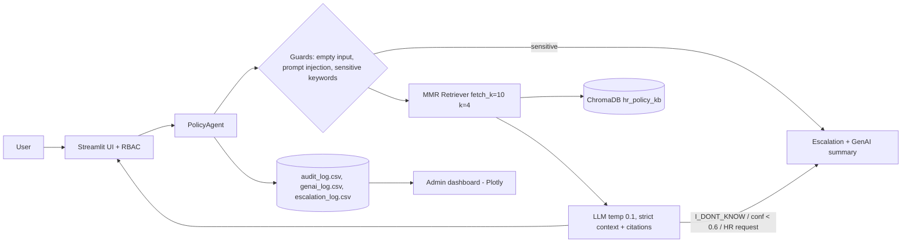

# Employee Policy Query Agent (GENAI-AGENT-009)

RAG-based HR assistant: grounded answers with `[Document, Page]` citations, multi-turn memory,
human escalation with a GenAI 3-line handoff summary, Streamlit chat UI, role-based access, admin analytics.

## Setup
```bash
python -m venv venv && source venv/bin/activate      # Windows: venv\Scripts\activate
pip install -r requirements.txt
cp .env.example .env                                  # add your OPENAI_API_KEY
python data_generator.py                              # creates /data (3 PDFs + tickets CSV)
python ingest.py                                      # chunk + embed + store in ChromaDB
streamlit run app.py
python evaluate.py                                    # 50-query evaluation -> /output
```
Demo logins: `employee/employee123`, `hr/hr123`, `admin/admin123`.

## Architecture


## Files
| File | Purpose |
|---|---|
| `data_generator.py` | Builds sample PDFs (40/10/15 pages) and 1000-row tickets CSV |
| `ingest.py` | pdfplumber/pandas loaders, chunking (800/150), embeddings, ChromaDB |
| `rag.py` | RAG chain, window memory (k=5), escalation, summary, caching, error handling |
| `app.py` | Streamlit UI: chat, feedback, escalations, admin analytics, uploads |
| `evaluate.py` | 30 in-scope + 10 out-of-scope + 10 escalation queries |

## Evaluation results
Run `python evaluate.py` and paste the contents of `output/eval_metrics.json` here.
